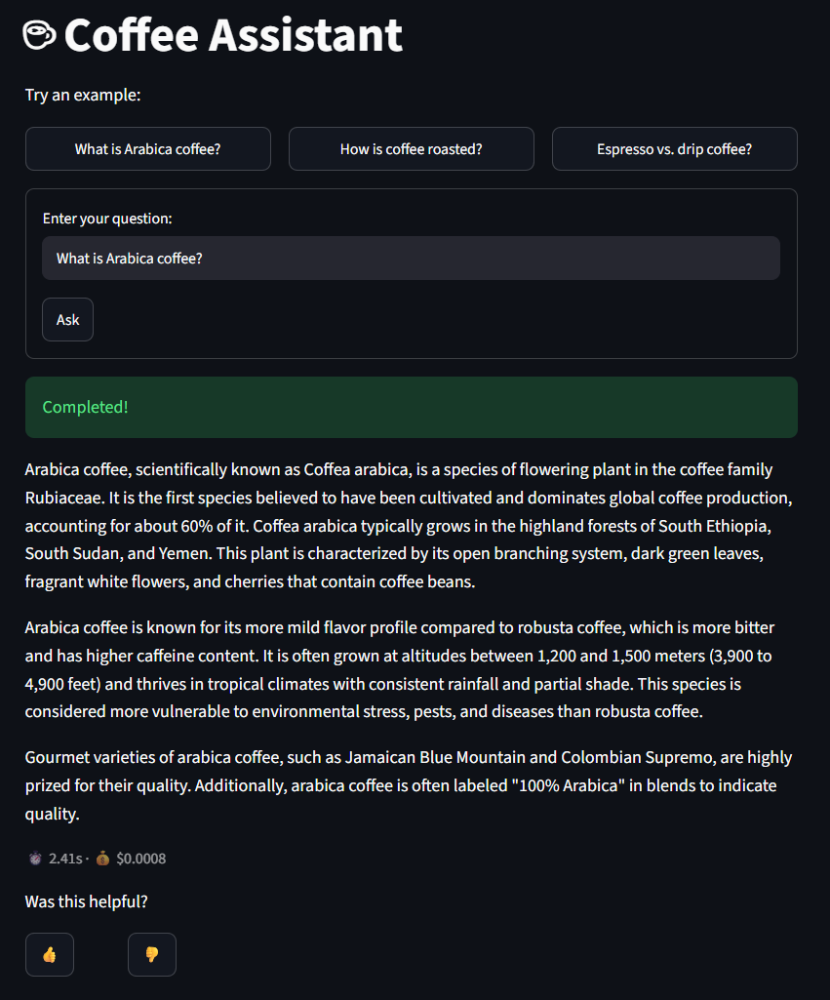
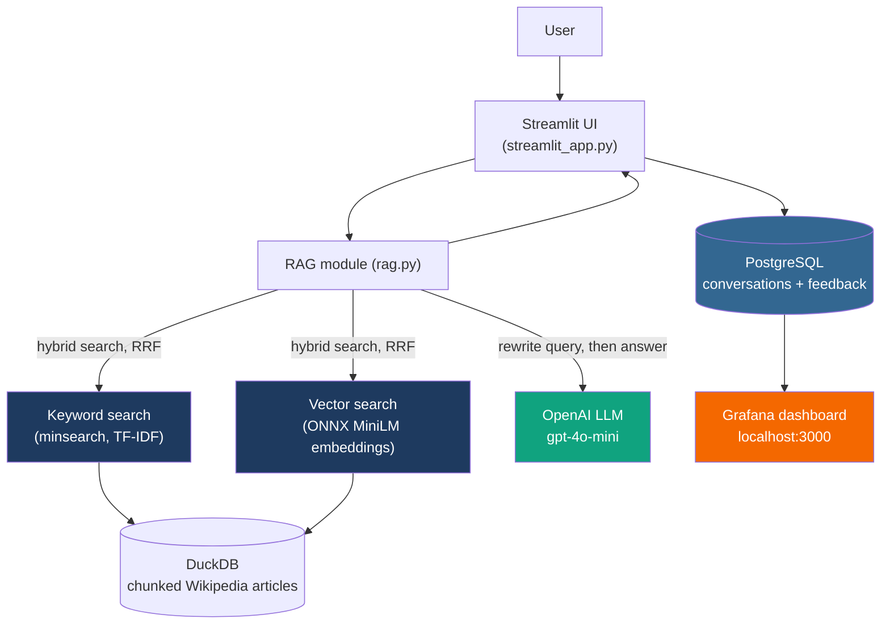
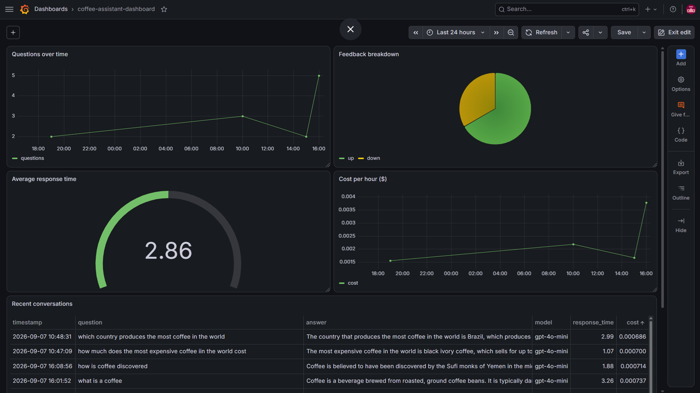
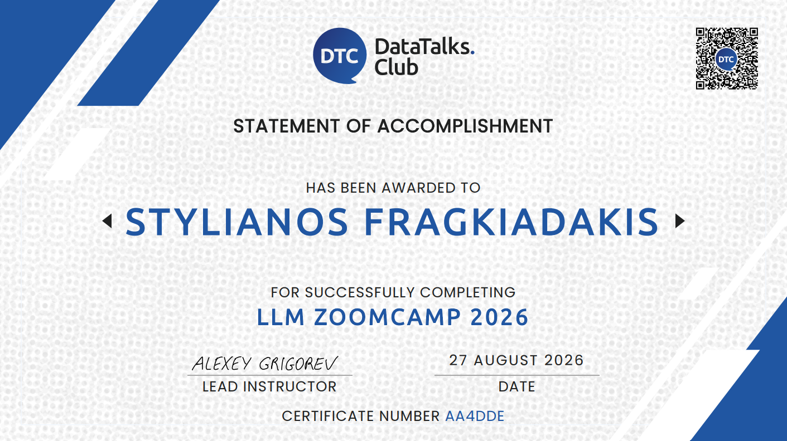

# Coffee Assistant

A RAG chatbot that answers coffee questions from Wikipedia articles, with measured retrieval and answer quality.
Capstone project of LLM Zoomcamp 2026 ([certificate](#certificate)).

**Results:** hybrid search finds the right chunk in 75% of test questions (Hit Rate 0.75 vs. 0.56 keyword-only) ·
97 of 100 test answers rated relevant by an LLM judge.

**Live demo:** [coffee-assist.streamlit.app](https://coffee-assist.streamlit.app/). The first load after a restart takes about 10 seconds.

## Problem

Learning about coffee (origins, roasting, brewing methods, regional differences) usually
means digging through long, disconnected Wikipedia articles to find one specific answer.
Coffee Assistant is a RAG chatbot that lets you just ask ("What's the difference between
Arabica and Robusta?", "How is coffee roasted?") and get a direct, sourced answer pulled from
that same set of articles, instead of reading through them yourself.



## Quickstart

```bash
cp .env.example .env    # add your OPENAI_API_KEY
docker compose up -d --build
docker compose run --rm app uv run python -c "from coffee_assistant.db import init_db; init_db()"   # creates missing tables only, safe to run again
```

The app runs at http://localhost:8501, Grafana at http://localhost:3000. The image
bakes in the prebuilt DuckDB index and ONNX embedder model, so it needs no outbound
network calls to start.

## Data

Coffee-related Wikipedia articles (Coffee, Espresso, Coffee roasting, Arabica coffee,
coffee-producing regions, etc.), ingested and chunked via a [dlt](https://dlthub.com/)
pipeline into a local DuckDB database.

The original plan was to use [Coffee Review](https://www.coffeereview.com/) tasting
reviews as the primary source, pending permission from the site (email sent to the
lead reviewer). Permission hadn't come through by the project deadline, so Wikipedia,
always the fallback path, is what's in production. Nothing about the pipeline is
Wikipedia-specific. Adding Coffee Review later means a second `dlt` source feeding the
same DuckDB table, without rebuilding anything.

## Full setup

```bash
uv sync
```

Copy `.env.example` to `.env` and add your `OPENAI_API_KEY`. The `POSTGRES_*`/`GRAFANA_*`
vars are only needed for monitoring, and the defaults work fine for local use.

### Running locally

```bash
uv run streamlit run streamlit_app.py
```

Opens a browser UI with a question box. On startup it loads the chunks from
`data/coffee.duckdb` and their precomputed vectors from `data/embeddings.npz`. If the
vectors file is missing or doesn't match the chunks, it embeds all chunks instead
(slower). Every question after that hits the cached index directly. If you're not
running Postgres/Grafana in Docker too, start just those two:
`docker compose up -d postgres grafana`.

After changing the articles, rebuild both data files:

```bash
rm data/coffee.duckdb data/embeddings.npz
uv run python -m scripts.build_embeddings
```

### From Python

```python
from coffee_assistant.rag import rag

rag("What regions produce Arabica coffee?")
```

### Running the tests

```bash
uv run pytest
```

Unit tests live in `tests/` and run without a database or model download. `test_rag.py`
still needs `OPENAI_API_KEY` set, because `rag.py` creates the OpenAI client when it is
imported. The tests replace the LLM with a fake, so no API call is made.

## Ground truth

`notebooks/ground-truth-generation.ipynb` generates 5 synthetic user questions per chunk with
`gpt-4o-mini`, keyed by `chunk_id`, saved to `data/ground-truth-retrieval.csv`
(504 chunks, 2520 questions), used for the retrieval and LLM evaluation steps.

## Retrieval evaluation

`notebooks/retrieval-eval.ipynb` evaluates three retrieval strategies against the
ground-truth question set, using Hit Rate and MRR (top 10 results):

| Method | Hit Rate | MRR |
|---|---|---|
| Keyword (TF-IDF) | 0.556 | 0.338 |
| Vector (ONNX MiniLM embeddings) | 0.633 | 0.404 |
| Hybrid (RRF, k=60 default) | 0.751 | 0.391 |
| **Hybrid (RRF, k=1)** | **0.751** | **0.421** |

Hybrid search merges keyword and vector rankings via Reciprocal Rank Fusion (RRF). It
wins on Hit Rate outright, and with a tuned `k=1` it also beats vector search on MRR.
The RRF literature default of `k=60` is tuned for rankings in the thousands and barely
separates the candidates in a top-10 list (see the notebook for the full explanation). **Hybrid search with `k=1` is used in production**, in
`coffee_assistant/retrieval.py`'s `hybrid_search()`, called from `rag.py`'s `search()`.

Vector embeddings come from a local ONNX MiniLM model (`coffee_assistant/embedder.py`,
adapted from the LLM Zoomcamp `02-vector-search` module). It needs no API calls and no
PyTorch, which keeps the Docker image small.

### Query rewriting

A real user typed "coffeine" instead of "caffeine", and search found nothing useful. So
before searching, the app now asks gpt-4o-mini to fix the question's spelling and wording
(`rag.rewrite_query()`). Only the search uses the rewritten question. The answer still uses
the user's own words.

Tested on 500 ground-truth questions, as written and with typos added (hybrid search):

| Questions | Rewriting | Hit Rate | MRR |
|---|---|---|---|
| As written | no | 0.722 | 0.422 |
| As written | yes | 0.720 | 0.397 |
| With typos | no | 0.642 | 0.353 |
| With typos | **yes** | **0.742** | **0.409** |

On clean questions rewriting changes almost nothing. With typos it brings search back up
to clean-question level. Real users make typos, so **rewriting is used in production**.

**Best practices:** hybrid search (combining keyword and vector search, evaluated above)
and query rewriting are both used in production.

## LLM evaluation

`notebooks/llm-eval.ipynb` compares two RAG prompts on 100 sampled ground-truth
questions, judged by gpt-4o-mini as an LLM judge (NON_RELEVANT / PARTLY_RELEVANT / RELEVANT):

| Prompt | Relevant | Partly relevant | Non relevant |
|---|---|---|---|
| **Default** | **0.97** | 0.02 | 0.01 |
| "I don't know" variant | 0.91 | 0.03 | 0.06 |

The default prompt wins over an alternative that explicitly allows the model to say
"I don't know" when context is insufficient.

### Round 2: query rewriting + safer prompt

After the "coffeine" question, the bot answered with the *fatal* dose of caffeine
(75–100 cups) instead of the safe daily amount. Two changes followed: query rewriting
(see [above](#query-rewriting)) and one extra prompt rule, *don't swap in a different
number, like a fatal dose when asked about daily intake*. Tested on the same 100 questions:

| Setup | Relevant | Partly relevant | Non relevant |
|---|---|---|---|
| Old (default prompt, no rewriting) | 0.96 | 0.02 | 0.02 |
| First try (also "say so if the context doesn't answer") | 0.87 | 0.06 | 0.07 |
| **New (rewriting + narrow rule)** | **0.98** | 0.01 | 0.01 |

The first try made the bot give up too often, so only the narrow rule was kept. The new
setup is used in production (`rag.py`), and the caffeine question now gets the right answer
(under 400 mg a day for adults).

## Architecture



## Monitoring

Every question asked in the Streamlit app is logged to Postgres (question, answer, model,
prompt, token counts, response time and estimated cost), and each answer has 👍/👎 feedback
buttons that log to a separate `feedback` table (`coffee_assistant/db.py`). See
[Quickstart](#quickstart) to bring up Postgres + Grafana alongside the app.

Grafana (`localhost:3000`, default login `admin`/`admin`) has a 5-panel dashboard built on
top of those two tables:



- **Questions over time:** question volume, bucketed hourly.
- **Feedback breakdown:** thumbs up vs. down.
- **Average response time:** RAG pipeline latency.
- **Cost per hour ($):** estimated OpenAI spend, bucketed hourly.
- **Recent conversations:** a live table of the latest Q&A pairs with cost/latency.

The dashboard isn't provisioned automatically. `grafana/dashboard.json` is the exported
dashboard definition. Import it via Grafana's UI (Dashboards → New → Import) to reproduce it.

## Decisions and trade-offs

- **Wikipedia over Coffee Review**: the primary source was pending third-party
  permission that didn't arrive in time (see [Data](#data)). Wikipedia was the
  planned fallback from the start, so the pipeline and eval work didn't need to
  change when the deadline hit.
- **Hybrid search + gpt-4o-mini**: hybrid search (RRF) beat keyword-only and
  vector-only on Hit Rate and MRR (see [Retrieval evaluation](#retrieval-evaluation)),
  and with query rewriting gpt-4o-mini scored 0.98 RELEVANT
  (see [LLM evaluation](#llm-evaluation)). That is good enough that a larger, pricier
  model wasn't worth it.
- **Safety over a perfect score**: the extra prompt rule exists because of a real
  wrong answer (a fatal dose given as a daily amount). A broader "say so if you don't
  know" rule was tried and dropped because the bot gave up too often.
- **Build once, load at start**: the demo used to fetch 31 Wikipedia articles and
  embed 515 chunks on every cold start, always with the same result. Now the chunks
  and their vectors are built once and committed to git, so text and vectors come
  from the same snapshot. Measured on Streamlit Cloud: ~20 s → ~10 s to the first
  page (locally, the embedding step went from 4.8 s to 0.2 s). The Docker image
  copies the same snapshot, so it depends only on git and serves the data the eval
  measured.

## Troubleshooting

**Local Postgres: `password authentication failed`**

- **Symptom:** the app answered, but saving the conversation failed. The Postgres log
  showed `password authentication failed for user "coffee_assistant_owner"`.
- **Diagnosis:** a login from inside the container returned
  `role "coffee_assistant_owner" does not exist`. With the old default user `user`
  from `.env.example`, `psql -l` listed the databases, but they held no tables.
- **Root cause:** the Postgres image creates `POSTGRES_USER` only on the first start
  with an empty data volume. The `postgres_data` volume was created in September
  with `user`, so the later change in `.env` had no effect.
- **Fix:** checked that the volume held no data, removed only that volume
  (`docker compose rm -sf postgres`, `docker volume rm coffee-assistant_postgres_data`)
  and started Postgres again. Then created the tables with `init_db()` inside the app
  container, where `POSTGRES_HOST` always points to the local Postgres. One test
  question then saved one row.
- **Lesson:** the `POSTGRES_*` variables are read once. After changing them, recreate
  the volume (or change the user with SQL if the data matters).

## Project structure

- `coffee_assistant/ingest.py`: fetches Wikipedia articles, chunks them, loads them
  into DuckDB via a dlt pipeline, and builds the keyword search index.
- `coffee_assistant/embedder.py`: local ONNX MiniLM embedder used for vector search
  (no API calls). It downloads the model into `models/` (gitignored) on first use via
  `download_embedder.py` if it isn't already there.
- `coffee_assistant/retrieval.py`: keyword, vector, and hybrid (RRF) search. This is
  the production search used by `rag.py`.
- `coffee_assistant/rag.py`: query rewriting, prompt building and the LLM call.
  `search()` delegates to `retrieval.hybrid_search()`. It also tracks response time and
  estimated cost (rewrite + answer).
- `coffee_assistant/db.py`: Postgres logging. `init_db()` creates the `conversations`/
  `feedback` tables, `save_conversation()`/`save_feedback()` write to them.
- `streamlit_app.py`: Streamlit UI. A question box that calls `rag()`, displays the
  answer with token usage, logs the conversation, and shows +1/-1 feedback buttons.
- `tests/`: pytest unit tests for the RRF fusion and vector search in `retrieval.py`,
  and for `rag()` with a fake LLM and fake search (the rewritten question goes to
  search, the original to the prompt, tokens from both calls are summed), and for the
  tool-calling loop `answer_with_tools()` with a fake model and a fake `web_search`
  (the tool runs with the model's arguments, its result goes back with the same
  `tool_call_id`). The web search provider is not connected yet. Config in
  `pyproject.toml` under `[tool.pytest.ini_options]`.
- `Dockerfile` / `docker-compose.yml`: containerize the app (Streamlit), Postgres, and
  Grafana into one stack (see [Quickstart](#quickstart) above).
- `grafana/dashboard.json`: exported Grafana dashboard definition (see
  [Monitoring](#monitoring) above).
- `notebooks/ground-truth-generation.ipynb`: generates the ground-truth question set
  used for retrieval/LLM evaluation.
- `notebooks/retrieval-eval.ipynb`: evaluates keyword vs. vector vs. hybrid search,
  and query rewriting (results in [Retrieval evaluation](#retrieval-evaluation) above).
- `notebooks/llm-eval.ipynb`: compares RAG prompts with an LLM judge, both rounds
  (results in [LLM evaluation](#llm-evaluation) above).
- `data/`: source titles list, ground-truth CSV, and LLM-eval results, round 1
  (`rag-eval-default.csv`, `rag-eval-v2.csv`) and round 2 (`rag-eval-round2-old.csv`,
  `rag-eval-round2-first-try.csv`, `rag-eval-round2-new.csv`). Also the built knowledge
  base: `coffee.duckdb` (chunks) and `embeddings.npz` (their vectors + chunk IDs).
- `scripts/build_embeddings.py`: embeds all chunks once and saves `data/embeddings.npz`.
- `scripts/time_startup.py`: measures how long each startup step takes.
- `requirements.txt`: pip-format dependency list generated from `pyproject.toml`/`uv.lock`
  via `uv export --no-dev --no-hashes --no-emit-project --format requirements-txt -o requirements.txt`,
  for hosts (e.g. Streamlit Community Cloud) that don't install from `uv.lock` directly.
  Regenerate it after changing dependencies.

## Certificate

Built as the capstone project of [LLM Zoomcamp 2026](https://github.com/DataTalksClub/llm-zoomcamp) by DataTalks.Club.


